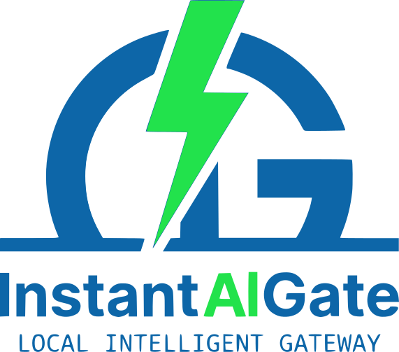
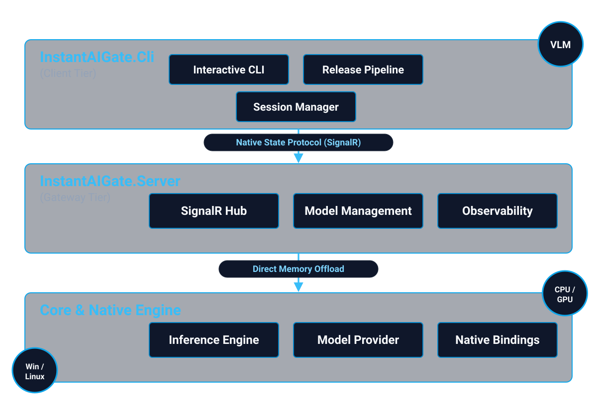

<p align="center">
  
</p>

<p align="center">
  
  
  
  
  
</p>

**InstantAIGate** is a high-throughput, deterministic AI inference gateway developed by Instancium, an independent R&D laboratory. Engineered on a compiled, cross-platform .NET 10 architecture with direct native memory bindings, it establishes Architectural Autonomy and Vendor Independence by allowing teams to deploy production-grade AI solutions within a controlled data perimeter.

## The Philosophy: Controlled AI Context & Specialized Stability

Unlike conventional stateless proxies that attempt one-size-fits-all universality, InstantAIGate is purpose-built for deep, production-grade memory control and deterministic behavior. 

- **Architectural Specialization:** The Qwen family of models is our reference architecture and first-class citizen. While the underlying boundary (`llama.cpp` / `mtmd`) is model-agnostic, additional model families are integrated only after strict validation, determinism checks, and hardware-profile tuning via the `config/model_catalog.json` curation pipeline.
- **True State Transparency:** We reject opaque server-side mitigations like hidden sliding windows, lossy token summarization, or unseen system prefixes. Clients gain direct visibility into exact token boundaries, physical cache reservations, and state shifts.

> You cannot control an intelligence if you do not control its memory. InstantAIGate provides the raw primitives to manage conversational state explicitly, reliably, and deterministically.

For a definitive list of officially supported and tested model configurations, refer to the [`config/model_catalog.json`](config/model_catalog.json) file.


## Key Features

### 1. Multi-Model VRAM Pool & Orchestration
- **Concurrent Residency:** Host generative chat/vision models (`LLM` / `VLM`) and dedicated `Embedding` models side-by-side in GPU VRAM without contention.
- **Isolated Context Pools:** Each loaded model maintains its own independent context pool (`MaxContexts`), active lease counter, and concurrency semaphore. 
- **Targeted Operations:** Execute type-scoped hot-swaps (`SwapModelAsync`) or targeted VRAM purges (`PurgeIdleContextsAsync`) on specific models without disrupting parallel workloads.

### 2. Native Embeddings & Auto-Routing
- **High-Throughput Vector Generation (`GenerateEmbeddingsAsync`):** Stateless batch token decoding with optional $L_2$ unit-vector normalization.
- **Dimension Introspection (`GetEmbeddingDimensionAsync`):** Query native vector width (`n_embd`) directly to provision vector indices prior to ingestion.
- **Intelligent Auto-Routing:** Embedding requests missing a specific repository ID (or targeting a chat model) are automatically routed to the active dedicated embedding model via the `EmbeddingModelResolver`.

### 3. Direct KV-Cache Control
- **Prefix Checkpointing (`RollbackSession`):** Instantly roll back to fixed token boundaries without re-evaluating preceding prefixes (backed by `llama_memory_seq_rm`).
- **Selective Sequence Shifting (`ShiftSessionCache`):** Perform native sliding window operations, excising intermediate turns while preserving system prompts and visual projection tokens (backed by `llama_memory_seq_add`).
- **Context Recycling:** Pre-allocated native `llama_context` slots are pooled and reused across sessions to maximize throughput.

### 4. Zero-Mutation Policy & Fail-Safe Guard
- The gateway enforces a strict zero-mutation policy: what you send is exactly what resides in memory. No silent pruning or surprise drops.
- **Fail-Safe Guard:** Token capacity is strictly validated *before* dispatching to native decoding routines. Capacity breaches trigger a `ContextOverflowException` to prevent engine crashes.

### 5. Native State Protocol (SignalR)
- **High-Performance Transport:** Full-duplex interaction over a single `/hub/gateway` endpoint with incremental delta transmission (`SendPromptDelta`).
- **Single-Pass Media Tokenization:** Image embeddings are computed once and pinned in the KV-cache, eliminating repetitive binary transfers in multi-turn VLM chats.
- **Role-Based Access Control (RBAC):** API Keys enforce `GatewayUser` policies for data operations and `GatewayAdmin` policies for control-plane and memory management.

### 6. Real-Time Observability
- **Event-Driven Telemetry:** Admin metrics (VRAM leases, request backpressure), native model details, and gateway operational state transitions are streamed reactively without polling.
- **Native Log Interception:** C++ `stderr` from `llama.cpp` and `mtmd` is captured natively and piped to admin clients via `SignalRLoggerProvider`.

### 7. Autonomous Startup Pipeline
- **Auto-Provisioning:** Configure startup arrays (`InstantAIGate:StartupModel`) with distinct hardware profiles (e.g., `Default` vs. `Embedding`). The gateway automatically downloads missing GGUF files, validates headers, and loads them sequentially into VRAM.
- Ready for orchestrator integration via `/health/live` and `/health/ready` probes.

### 8. VRAM Leak Protection & Resilience
- **Disconnect Grace Period:** Network interruptions preserve session context in VRAM for a configurable window (default: 30s), enabling seamless client reconnections.
- **Safe Eviction:** Abandoned sessions exceeding the idle timeout are safely synchronized with internal `ExecutionGate` semaphores before being returned to the VRAM pool.

### 9. Diagnostic Web Dashboard *(Experimental)*
> **Experimental Feature:** `InstantAIGate.Dashboard` is currently in an experimental stage. UI workflows, metrics heuristics, and control-plane endpoints may change in minor releases.

A Blazor WebAssembly diagnostic console (`src/InstantAIGate.Dashboard`) connected to the gateway Control Plane (`/hub/gateway`, requires an Admin API key):
- **1 Hz Hardware & Memory Retention Diagnostics:** Visualizes GPU VRAM (or Unified Memory on CPU-only hosts), compares loaded weights and estimated KV-cache against process memory, and flags suspected native memory retention or VRAM spillover risk.
- **Model Pool & Session Control:** Inspects per-model context slots (active leases, idle pooled contexts, unallocated slots) and active sessions with context fill bars, with guarded two-step controls to purge idle contexts, unload models, force-kill sessions, trigger .NET GC, or adjust queue limits.
- **Throughput & Native Log Terminal:** Tracks aggregate Prompt/Eval TPS and request queue utilization alongside a live, filterable native log stream and an in-memory admin operation audit journal.


## Architecture

InstantAIGate isolates client orchestration from the gateway server and underlying native execution backends.

<p align="center">
  
</p>

### A. Client Layer
- **Language Agnostic:** Integrates smoothly via official SignalR client libraries (JS/TS, Python, Go, Rust, C#).
- **Official .NET SDK (`InstantAIGate.Client`):** A ready-to-use, capability-segregated SignalR client library providing connection management, streaming chat, embeddings, Data Plane telemetry, and pluggable KV-cache context strategies.
- **Reference Client (`InstantAIGate.Cli`):** An open-source CLI demonstrating multi-model management, token budgeting, checkpointed ingestion, and multimodal streaming.
- **Diagnostic Console (`InstantAIGate.Dashboard`, *Experimental*):** A Blazor WebAssembly web UI for real-time Control Plane telemetry and VRAM/session administration.

### B. Gateway Core (`InstantAIGate.Server`)
- Acts as the central coordinator, mapping persistent `SessionId` tokens directly to leased native memory handles (`InferenceContext`).
- Manages the thread-safe `GatewayStateManager`, handles zero-mutation delta ingestion, and routes requests to the appropriate model pools.

### C. Native Engine Boundary
- **Dynamic Request Queue:** Provides backpressure control, prioritizing and throttling requests to prevent hardware saturation.
- **P/Invoke Bindings:** `LlamaNative` and `MtmdNative` execute hardware-accelerated tensor operations directly via compiled runtimes, avoiding runtime virtualization overhead.

## Native Runtimes & Binaries

InstantAIGate interfaces directly with compiled `llama.cpp` inference binaries (`v0.4.0`) located in `src/InstantAIGate.Native/runtimes/`. 

> **Roadmap Note:** Currently, native binaries can be built independently using the provided build scripts. In upcoming releases, this process will be simplified by bundling precompiled binary drivers directly with the repository code.

### Manual Build Instructions

#### Windows (`win-x64`)
1. Ensure CMake and Visual Studio Build Tools are installed.
2. Run the build script:
   ```powershell
   .\src\InstantAIGate.Native/runtimes/build/start.ps1
   ```
   *Automatically clones `llama.cpp` (if missing), checks out `v0.4.0`, configures Vulkan support, and places artifacts in `win-x64/native`.*

#### Linux (`linux-x64`)
1. Ensure Docker and Docker Compose are installed.
2. Run the build script:
   ```bash
   chmod +x src/InstantAIGate.Native/runtimes/build/start.sh
   ./src/InstantAIGate.Native/runtimes/build/start.sh
   ```
   *Compiles libraries inside a container and extracts them to `linux-x64/native` preserving symlinks via tarballs.*

## Client Integration & Protocol Contract

The complete wire contract is documented in the [Client Integration Guide](docs/client-integration-guide.md).

### .NET Integration Packages

InstantAIGate provides two complementary NuGet packages with distinct responsibilities:

| Package | Purpose | When to Use |
|---------|---------|-------------|
| **[InstantAIGate.Core](https://www.nuget.org/packages/InstantAIGate.Core/)** | **Contracts & DTOs for building custom clients.** Contains strongly-typed DTOs (`InstantAIGate.Core.Dtos.*`), exceptions (`ContextOverflowException`), and hub contracts (`IGatewayHub`, `IGatewayHubAdmin`). | Use when implementing a custom transport layer, low-level SignalR integration, or Control Plane (`IGatewayHubAdmin`) tooling without taking on SDK abstractions. |
| **[InstantAIGate.Client](src/InstantAIGate.Client/README.md)** | **Ready-to-use SDK for connecting to the gateway.** Built on top of `InstantAIGate.Core`, providing a shared SignalR connection, capability-segregated clients, and reusable KV-cache strategies. | Use in .NET applications that need immediate, production-ready Data Plane integration without wiring `HubConnection` boilerplate manually. |

#### What `InstantAIGate.Client` Provides
- **Transport Plane (`IGatewayConnection`):** Lazy, thread-safe SignalR connection management, Bearer API key authentication, automatic reconnect backoff, and `GatewayOperationalStatus.Ready` gating.
- **Capability Clients:**
  - `IChatClient` / `IChatClientFactory` — multimodal `ChatMessage` streaming (`StreamAsync` / `CompleteAsync`) and plain-string extensions, with structured `ContextOverflowReport` exception mapping.
  - `IGatewayEmbeddingClient` — single and batch dense vector generation returning `EmbeddingResponse`, with optional lazy dimension validation (`ExpectedEmbeddingDimension`).
  - `IGatewayTelemetryClient` — read-only Data Plane queries (`GetGatewayStatusAsync`, `GetActiveModelDetailsAsync`, `GetLoadedModelsDetailsAsync`, `GetSessionTokenCountAsync`).
- **Pluggable KV-Cache Strategies (`IChatContextStrategy`):** Built-in `Stateless` (destroy per turn), `Conversational` (retain until disposal), and `Checkpointed` (pin and rollback prefix via `RollbackSession`) lifecycle strategies, plus DI registration via `services.AddInstantAIGateClient(...)`.

>
> ### Hardware Acceleration & Cross-Platform Execution
>
> Powered by `llama.cpp` with native **Vulkan** backend integration, InstantAIGate breaks free from vendor lock-in. It delivers hardware-accelerated inference across a vast spectrum of GPUs without requiring heavy proprietary stacks like CUDA:
>
> - **NVIDIA GPUs:** GeForce, Quadro, Tesla (via Vulkan ICD)
> - **AMD Radeon GPUs:** RX series, Vega, RDNA architectures
> - **Intel Arc & Integrated Graphics:** Xe architecture
> - **CPU Fallback:** Full support on CPU-only environments with configurable concurrency.
>
> **Supported Platforms:**
>
> | Platform | Architecture | Runtime |
> |----------|-------------|---------|
> | Windows | x64 | `runtimes/win-x64/*.dll` |
> | Linux | x64 | `runtimes/linux-x64/*.so` |
>

## Deployment

- **Windows Service:** Install/uninstall scripts provided in `deploy/windows-service/`.
- **Docker:** `Dockerfile` and `docker-compose.yml` in `deploy/docker/` for containerized Linux deployment.
- **Standalone:** Self-contained single-file publish via `dotnet publish`.


## ⚠️ Versioning & Stability Policy 

InstantAIGate follows a pragmatic variant of [Semantic Versioning](https://semver.org/).

### Pre-2.0 Status
Until version `2.0.0` is released, the public API and wire contract are not frozen. Breaking changes to SignalR hub methods or the native boundary may be introduced in **minor** releases. The `1.x` line is a stabilization track.

### Version Components
| Segment | Meaning |
|---------|---------|
| **Major** (`2.x.y`) | Reserved for the first stable release (2.0.0). Subsequent major updates reflect fundamental architectural shifts or major roadmap milestones. |
| **Minor** (`x.Y.0`) | New features and behavioral changes that **may affect client applications**. Review the Integration Guide before upgrading. |
| **Patch** (`x.y.Z`) | Bug fixes that **do not alter the integration rules**. Existing DTOs retain their shape. Safe to upgrade. |

The NuGet packages **`InstantAIGate.Core`** and **`InstantAIGate.Client`** are versioned and released together as the primary stability boundary for downstream .NET consumers.


## 📄 License & Trademark

Copyright (c) 2026 Instancium™ (https://instancium.com). All rights reserved.

### Source Code License
This project's source code is licensed under the **Apache License 2.0**. See the [LICENSE](LICENSE.txt) file for the full text.

### Third-Party Dependencies
For a comprehensive list of dependencies, models, and their respective licenses, please refer to the [Third-Party Notices & Licenses](THIRD-PARTY-NOTICES.md) document.

### Branding & Trademark
The "InstantAIGate" name, logos, and branding assets (in the `media` directory) are the exclusive property of Instancium and are licensed under the [CC BY-NC-ND 4.0](https://creativecommons.org/licenses/by-nc-nd/4.0/) license. They may be used solely to refer to this original project without modification or commercial implication.