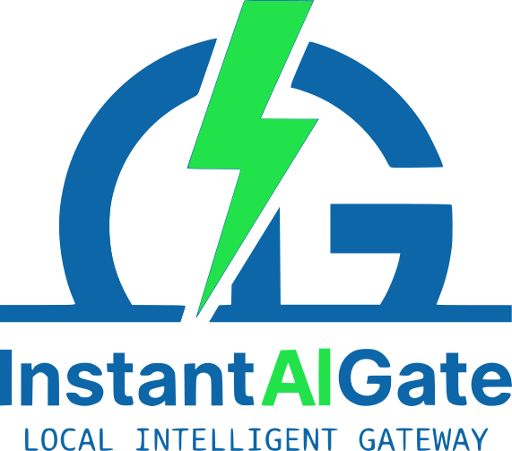
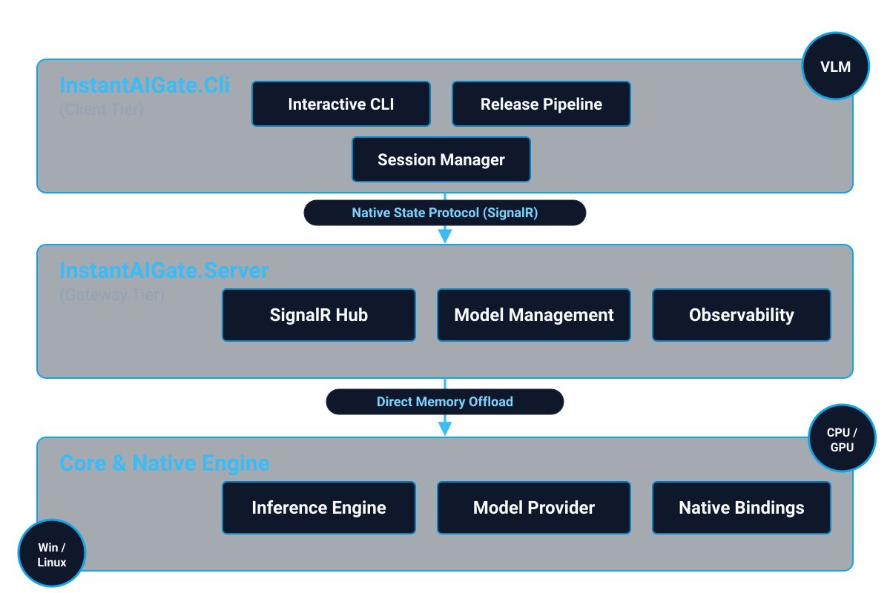

  

  
  
  
  
  
  

InstantAIGate is a high-throughput, deterministic AI inference gateway developed by Instancium, an independent R&D laboratory. Engineered as the laboratory's foundational platform for powering next-generation sovereign applications and intelligent systems, it delivers a compiled, cross-platform .NET 10 architecture with direct native memory bindings to inference engines, establishing Architectural Autonomy and Structural Resilience.

By serving as the laboratory's core inference gateway, InstantAIGate enables Instancium's ecosystem and downstream applications to orchestrate local models within a Controlled Data Perimeter. This foundation empowers engineering teams and enterprises to deploy production-grade AI solutions without forced dependencies on proprietary cloud APIs, guaranteeing Vendor Independence and uncompromised Digital Subjectivity.

## The Philosophy: Controlled AI Context & Specialized Stability

**Context. State. Memory. Control. Precision.**

Unlike conventional stateless proxies that attempt to be a generic, one-size-fits-all solution for every model architecture, InstantAIGate is purpose-built. We operate on the principle that forced universality inevitably degrades performance, introduces edge-case fragility, and kills quality. Therefore, our gateway is deeply specialized and rigorously optimized specifically for the Qwen family of models. Beyond their architectural excellence, our specialization is driven by a shared vision: we fully embrace Qwen's core philosophy and mission to democratize artificial intelligence (AGI) and make state-of-the-art models truly accessible to everyone.

Our development strategy prioritizes extreme stability and predictability over experimental feature bloat. We adhere to a strict curation philosophy: only thoroughly tested, rigorously validated, and guaranteed model configurations are integrated into the core runtime. This ensures production-grade reliability, deterministic behavior, and maximum hardware efficiency, eliminating the unpredictability of untested builds.

Cloud APIs often rely on opaque server-side mitigations—hidden sliding windows, lossy token summarization, and unseen system prefixes—that cause critical context drift, attention loss, and silent hallucinations. InstantAIGate rejects invisible optimizations:

- **Zero Silent Truncation:** What you send is exactly what resides in memory. No silent pruning, no surprise drops.
- **Hallucination & Drift Mitigation:** By strictly controlling KV-cache checkpoints and token boundaries, applications prevent attention degradation and maintain deterministic reasoning across long multi-turn sessions.
- **True State Transparency:** Clients gain direct visibility into exact token counts, physical cache reservations, and state shifts.

> You cannot control an intelligence if you do not control its memory. InstantAIGate provides the raw primitives to manage conversational state explicitly, reliably, and deterministically.

**Supported Models:** For a definitive list of officially supported, tested, and guaranteed Qwen model configurations, refer to the [`config/model_catalog.json`](config/model_catalog.json) file.

---

## Key Features

### 1. Direct KV-Cache Control & Manipulation

Gain deterministic programmatic control over the physical KV cache allocated in GPU VRAM:

- **Prefix Checkpointing (`RollbackSession`):** Instant rollback to fixed token boundaries without re-evaluating preceding prefixes. Backed by `llama_memory_seq_rm`.
- **Selective Sequence Shifting (`ShiftSessionCache`):** Sliding window operations in native memory. Excise intermediate turns while preserving system prompts and visual projection tokens. Backed by `llama_memory_seq_add`.
- **Prefix Tree Context Pooling:** Maximize throughput by reusing shared token prefixes across concurrent sessions via `PrefixTreeContextPool`.

### 2. Zero-Mutation Policy & Fail-Safe Guard

Strict memory management ensures reliability:

- The gateway **never** silently truncates or summarizes session context.
- **Fail-Safe Guard:** Validates token capacity *before* native decoding routines are called. If capacity is exceeded, it halts execution and throws a `ContextOverflowException`, preventing memory corruption and engine crashes.

### 3. Native State Protocol (SignalR)

High-performance, full-duplex transport over a single unified hub endpoint (`/hub/gateway`):

- **Incremental Delta Transmission:** Clients transmit only the latest prompt delta (`SendPromptDelta`), minimizing payload size.
- **Session Persistence:** Context handles remain leased in VRAM across turns for minimal Time-To-First-Token (TTFT). Managed by `SessionInferenceManager` with idle timeout eviction.
- **Single-Pass Media Tokenization:** Image embeddings are computed once via `mtmd` and pinned in the KV cache, enabling multi-turn conversations without repeated binary transfers.
- **Role-Based Access Control:** Data plane operations require `GatewayUser` policy; control plane operations (model load/swap/unload, queue management) require `GatewayAdmin` policy. Enforced via API Key authentication middleware.

### 4. Real-Time Observability & Telemetry

Event-driven observability streamed through the same `/hub/gateway` hub, segmented by SignalR groups:

- **Admin Telemetry (`GatewayAdminGroup`):** VRAM context leases, request queue backpressure (`InferenceMetrics`), native model details, and server-side logs. Broadcast is triggered reactively via `MetricsEventSource` channel on every state mutation—no polling, no fixed intervals.
- **Download Progress:** Live server-side download progress (`ReceiveDownloadProgress`) streamed to subscribed clients via per-model SignalR groups.
- **Gateway Status:** Operational state machine (`Uninitialized → ModelDownloading → ModelLoading → Ready / Faulted`) broadcast to all connected clients on every transition.
- **Native Log Interception:** C++ `stderr` from `llama.cpp` / `mtmd` is captured via `NativeStreamRedirector` and piped to admin clients through `SignalRLoggerProvider`.

### 5. Autonomous Startup Pipeline

- **Auto-Download:** If the configured startup model is absent on disk, `ModelStartupWorker` automatically downloads it with resumable, parallel chunked transfer before loading.
- **Auto-Load:** Once present, the model is loaded into VRAM and the gateway transitions to `Ready` state without manual intervention.
- **Health Probes:** `/health/live` (liveness, always 200) and `/health/ready` (readiness, reflects model load state) for orchestrator integration.

### 6. VRAM Leak Protection & Resilient Lifecycle

- **Disconnect Grace Period:** Transport interruptions (network blinks, Wi-Fi handoffs) preserve session context and KV-cache in VRAM for a configurable window (default: 30s), enabling clients to reconnect seamlessly without re-decoding prompts.
- **Connection-Bound Eviction:** Sessions not resumed within the Grace Period, or abandoned idle sessions exceeding the configured idle timeout (default: 3m), are automatically evicted and returned to the VRAM context pool safely.
- **Native Memory Safety:** All context release operations synchronize with internal `ExecutionGate` semaphores to ensure active native token decoding loops complete cleanly before context disposal.

## Architecture

InstantAIGate is designed around a decoupled, stateful architecture that isolates client orchestration from the gateway server and underlying native execution backends.

  

### System Layers

#### A. Client Layer: Universal Integration (CLI as Reference Client)

The inference gateway exposes a full-duplex, event-driven API. Any environment capable of establishing a WebSocket / SignalR connection can natively integrate with InstantAIGate:

- **Language Agnostic:** Seamless integration via official SignalR client libraries for JavaScript / TypeScript (browsers, Node.js, Electron), Python, Go, Rust, and .NET / C#.
- **InstantAIGate.Cli (Reference Implementation):** An included open-source reference client demonstrating how consumers can implement token budgeting, checkpointed ingestion (`RollbackSessionAsync`), sliding-window memory management (`ShiftSessionMemoryAsync`), and interactive streaming.

#### B. Gateway Core: `InstantAIGate.Server` (`GatewayHub`)

The actual inference gateway runtime. It manages high-concurrency client sessions and coordinates stateful interactions without mutating context:

- **Stateful Connection Lifecycle:** Maps transient client connection IDs and persistent `SessionId` tokens directly to leased native memory handles (`InferenceContext`).
- **Zero-Mutation Delta Ingestion:** Ingests only conversational deltas while maintaining strict prompt integrity.
- **KV-Cache Manipulation Interface:** Directly executes prefix rollback and sequence shift primitives on the host.
- **Fail-Safe Guard:** Intercepts out-of-budget contexts before dispatch to native routines, protecting hardware from crashes.
- **Operational State Machine:** `GatewayStateManager` provides a thread-safe, observable state machine for the gateway lifecycle.

#### C. Native Engine Boundary

The low-level C++ boundary executing hardware-accelerated tensor operations:

- **Dynamic Backpressure Queue:** `DynamicRequestQueue` prioritizes and throttles requests across active sessions to prevent VRAM saturation. Supports runtime capacity adjustment and pause/resume.
- **Prefix Tree Context Pool:** Reuses shared prefix token graphs and model weights across multi-tenant inference sessions.
- **Native Memory Operations:** Interacts directly with compiled `llama.cpp` / `mtmd` runtimes via P/Invoke bindings (`LlamaNative`, `MtmdNative`) for direct hardware offload without runtime virtualization overhead.

---

## Client Integration & Protocol Contract

The complete wire contract of the InstantAIGate gateway is formally documented in the [Client Integration Guide](docs/client-integration-guide.md). This document serves as the single source of truth for external developers and covers:

- Authentication mechanisms and role-based access control (RBAC).
- Complete SignalR Hub method signatures (Client → Server) and callbacks (Server → Client).
- Strict DTO schemas and the session memory model (KV-cache lifecycle, VRAM slots, disconnect Grace Period, and idle timeouts).
- Canonical client patterns for interactive chat, Map-Reduce pipelines, and reconnection logic.

### Typed Contracts for .NET

For C# / .NET developers, we provide the [InstantAIGate.Core](https://www.nuget.org/packages/InstantAIGate.Core/) NuGet package. It contains all strongly-typed DTOs (`InstantAIGate.Core.Dtos.*`) and interfaces, eliminating the need to manually parse JSON payloads and ensuring compile-time safety when interacting with the gateway.

---
>
> ### Hardware Acceleration & Cross-Platform Execution
>
> Powered by `llama.cpp` with native Vulkan backend integration, InstantAIGate breaks free from vendor lock-in. It delivers hardware-accelerated LLM/VLM inference across a vast spectrum of consumer and enterprise GPUs without requiring heavy proprietary stacks like CUDA:
>
> - **NVIDIA GPUs:** GeForce, Quadro, Tesla (via Vulkan ICD)
> - **AMD Radeon GPUs:** RX series, Vega, RDNA architectures
> - **Intel Arc & Integrated Graphics:** Xe architecture
> - **CPU Fallback:** Full inference support on CPU-only environments with configurable thread concurrency
>
> **Supported Platforms:**
>
> | Platform | Architecture | Runtime |
> |----------|-------------|---------|
> | Windows | x64 | `runtimes/win-x64/*.dll` |
> | Linux | x64 | `runtimes/linux-x64/*.so` |
>
---

## Deployment

- **Windows Service:** Install/uninstall scripts provided in `deploy/windows-service/`.
- **Docker:** `Dockerfile` and `docker-compose.yml` in `deploy/docker/` for containerized Linux deployment.
- **Standalone:** Self-contained single-file publish via `dotnet publish`.

---

## 📄 License & Trademark

Copyright (c) 2026 Instancium™ (https://instancium.com). All rights reserved.

### Source Code License

This project's source code is licensed under the Apache License 2.0. See the [LICENSE](LICENSE.txt) file for the full license text and permissions.

### Third-Party Dependencies

This project incorporates third-party software components, native runtimes, and model weights, each governed by its own respective license. For a comprehensive list of these dependencies, their licenses, and required acknowledgments, please refer to the [Third-Party Notices & Licenses](THIRD-PARTY-NOTICES.md) document.

### Branding & Trademark

The "InstantAIGate" name, logos, and all associated branding assets (including those located in the `media` directory) are the exclusive property of Instancium and are not covered by the Apache License 2.0.

These branding materials are licensed under the [Creative Commons Attribution-NonCommercial-NoDerivatives 4.0 International License (CC BY-NC-ND 4.0)](https://creativecommons.org/licenses/by-nc-nd/4.0/).

- **Permitted Use:** You may use the official logos and name solely to refer to and link to this original project.
- **Restrictions:** You may not modify the branding assets, use them for commercial purposes, or use the name/logos in a way that implies official endorsement, sponsorship, or affiliation with Instancium without explicit prior written permission.